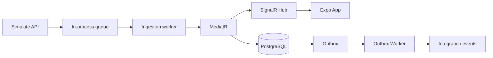

# OmniOps

> Cold-chain pharmaceutical delivery monitoring real time telemetry, excursion detection, and incident response


A temperature excursion during pharmaceutical transport can turn a $50 k shipment into medical waste before anyone notices. OmniOps monitors cold-chain delivery trucks in real time, detects cargo temperature excursions against per-shipment safe ranges, and alerts the team the moment cargo is at risk.

Telemetry is queued in-process into a .NET 9 backend (CQRS + MediatR), persisted in PostgreSQL, and streamed live to an Expo mobile client over SignalR. Each truck carries a named shipment (product, batch, value-at-risk), and every alert reads like a real cold-chain incident report.

The backend uses **Clean Architecture** with four layers, environment-driven configuration, and production-style reliability patterns: transactional outbox, idempotent processing, and bounded retries. It runs as **one API container plus PostgreSQL** — no message broker or cache server to operate.

**Deep dive:** [How a GPS packet becomes fleet intelligence →](https://bogdanvladevski.github.io/OmniOps/)

**Local setup:** [DEV-SETUP.md](DEV-SETUP.md)

---

## How it works



1. The **simulate endpoint** queues `VehicleTelemetry` packets on a bounded in-process queue.
2. **TelemetryIngestionWorker** dispatches each one as `ProcessTelemetryCommand` via MediatR, retrying transient failures.
3. The handler deduplicates by packet id, persists to PostgreSQL, updates the latest-telemetry cache, resolves the active shipment (`Shipment` entity), runs temperature-excursion detection, and broadcasts over SignalR.
4. When cargo temperature leaves the shipment's `MinSafeTempCelsius`–`MaxSafeTempCelsius` range (or trends toward it), a `ReceiveAlert` is broadcast with the product, batch, excursion duration and estimated value at risk — only after the data is committed.
5. Domain events are captured by an **EF outbox interceptor** in the same database transaction and later handed to the integration event publisher by **OutboxPublisherWorker**.

Detector state, deduplication locks and the latest-telemetry cache are held in process memory, so the API runs as a **single instance**.

---

## Features

| Area | Implementation |
|------|----------------|
| **Domain** | `Shipment` entity (product, batch, safe-temp range, value-at-risk) seeded for Truck-001/002/003 |
| **Excursion detection** | Per-shipment temperature excursion check + excursion duration tracking per fleet and vehicle |
| **Incident alerts** | `"{Product} batch {Batch} has been outside safe range for {N}s — est. value at risk: ${Value}"` |
| Ingestion | Bounded in-process queue with retry for transient failures; rejected packets are logged and counted |
| CQRS | MediatR commands, queries, logging/validation pipeline behaviours |
| Outbox | `OutboxSaveChangesInterceptor` + polling publisher |
| Idempotency | Per-packet processing lock (10-minute TTL) |
| Cache | In-memory latest-telemetry per vehicle |
| Real-time | SignalR vehicle + fleet groups, camelCase JSON |
| Observability | Serilog structured logging, OpenTelemetry tracing, Prometheus `/metrics` |
| Mobile | Expo fleet dashboard — live map, shipment KPIs, cold-chain alerts |

---

## API

| Method | Route | Description |
|--------|-------|-------------|
| `GET` | `/api/telemetry/fleet` | Latest cached telemetry for all configured fleet vehicles + summary KPIs |
| `GET` | `/api/telemetry/{vehicleId}` | Latest cached telemetry |
| `POST` | `/api/test/simulate/{vehicleId}?packets=N` | Queue mock telemetry for processing (`N` = 1–100) |
| `GET` | `/api/v1/jobs?scope=active\|delivered\|all` | Delivery jobs for the office board |
| `POST` | `/api/v1/jobs` | Create a delivery job (truck, driver, customer, destination); returns its tracking link |
| `GET` | `/api/v1/jobs/{id}` | Job with its proof-of-delivery documents |
| `GET` | `/api/v1/jobs/{id}/documents/{documentId}` | Download a delivery photo |
| `GET` | `/api/v1/driver/jobs?driverId=` | A driver's current jobs |
| `PUT` | `/api/drivers/{id}` | Change a driver's name or phone number |
| `POST` | `/api/v1/driver/jobs/{id}/arrived` | Driver arrived at the pickup or the delivery (starts the waiting clock) |
| `POST` | `/api/v1/driver/jobs/{id}/start` | Driver starts the trip |
| `POST` | `/api/v1/driver/jobs/{id}/locations` | Phone GPS points (batch; resending is safe) |
| `POST` | `/api/v1/driver/jobs/{id}/photos` | Upload a delivery photo (multipart, ≤ 10 MB) |
| `POST` | `/api/v1/driver/jobs/{id}/documents?kind=` | Loading note (`PickupDocument`), delivery photo, fridge-display photo (`TemperaturePhoto` + `temperatureCelsius`), receiver `Signature` or problem report (`Exception`) with form field `note`; `clientId` makes a resend safe, `capturedAt` is when it was taken |
| `POST` | `/api/v1/driver/jobs/{id}/deliver` | Confirm delivery — needs a photo, the recipient's name, and for refrigerated jobs a reading from the last 30 min |
| `POST` | `/api/v1/account/sign-up` / `sign-in` / `refresh` / `sign-out` | Company accounts and sessions |
| `POST` | `/api/v1/account/driver-codes` · `/api/v1/account/pair` | Office creates a one-time code; a driver's phone exchanges it for a driver sign-in |
| `GET`/`POST`/`PUT`/`DELETE` | `/api/v1/account/team…` · `PUT /api/v1/account/company` | Owners: team list, invitations, roles, removing people, reset links, company name |
| `GET`/`POST` | `/api/v1/account/invitations/{token}` · `…/accept` | Open and accept an invitation (no sign-in) |
| `POST` | `/api/v1/account/forgot-password` · `reset-password` · `password` · `sign-out-everywhere`; `PUT /api/v1/account/me` | Password reset and change, signing out everywhere, own name |
| `GET`/`PUT` | `/api/v1/billing/profile` | Invoice settings: company details, bank account, VAT, terms, numbering |
| `GET` | `/api/v1/invoices` | Overview: waiting for payment, overdue, paid, delivered jobs to invoice |
| `POST` | `/api/v1/invoices` | Invoice a delivered job (`send`: `"email"`, `"manual"` or omitted) |
| `POST` | `/api/v1/invoices/{id}/send` / `/paid` | Send (email or record) / mark as paid |
| `GET` | `/i/{token}` | Customer invoice page with proof of delivery (no login; printable) |
| `GET` | `/t/{token}` | Customer tracking page (no login; rate limited) |
| `GET` | `/api/public/track/{token}` | Data behind the tracking page |
| `GET` | `/health/live` | Liveness probe (process up) |
| `GET` | `/health/ready` | Readiness probe (Postgres) |
| `GET` | `/metrics` | Prometheus metrics (when enabled) |
| WS | `/api/stream/telemetry` | SignalR hub |

**SignalR hub**

| Direction | Method / event | Purpose |
|-----------|----------------|---------|
| Client → server | `WatchFleet()` | Join fleet group (used by Expo app) |
| Client → server | `WatchVehicle(vehicleId)` | Join vehicle group (single-vehicle clients) |
| Client → server | `UnwatchFleet()` / `UnwatchVehicle(vehicleId)` | Leave groups |
| Server → client | `ReceiveTelemetryUpdate` | Live telemetry payload (camelCase) |
| Server → client | `ReceiveAlert` | Incident and cargo-temperature alerts |

The server broadcasts to both vehicle and fleet groups; the mobile app calls `WatchFleet()` only to avoid duplicate events. See [backend docs](https://bogdanvladevski.github.io/OmniOps/#mobile) for the full client bootstrap flow.

Default fleet vehicles: `Truck-001`, `Truck-002`, `Truck-003` (configurable via `FLEET_VEHICLE_IDS` / `EXPO_PUBLIC_FLEET_VEHICLES`).

---

## Stack

| Layer | Technology |
|-------|------------|
| API | ASP.NET Core 9 Minimal APIs |
| Application | MediatR (CQRS) |
| Domain | `OmniOps.Core` |
| Infrastructure | EF Core, SignalR, hosted background workers |
| Database | PostgreSQL 16 |
| Mobile | React Native + Expo 54 |
| Containers | Docker Compose |

---

## Repository layout

```text
OmniOps/
├── backend/
│   ├── OmniOps.Api/              Endpoints, middleware, host
│   │   └── Configuration/        Environment, auth, health, observability
│   ├── OmniOps.Application/      Handlers, DTOs, behaviours
│   ├── OmniOps.Core/             Entities, interfaces, events
│   ├── OmniOps.Infrastructure/ Data, background workers, hubs
│   └── OmniOps.sln
├── frontend/             Expo mobile app
│   ├── components/       FleetMap, FleetDashboard, AlertsFeed
│   ├── contexts/         FleetContext (SignalR + REST snapshot)
│   └── utils/            fleetConfig, layout
├── docs/                 GitHub Pages pipeline deep-dive
├── infra/docker-compose.yml      Postgres + API
├── scripts/                      Dev utilities (e.g. dotnet-install.sh)
├── .env.example                  Backend environment template
└── DEV-SETUP.md                  Setup guide
```

**Dependency flow**

```text
OmniOps.Api
 ├── OmniOps.Application → OmniOps.Core
 └── OmniOps.Infrastructure → OmniOps.Application, OmniOps.Core
```

`OmniOps.Core` has no external package dependencies.

---

## Configuration

Copy `.env.example` to `.env` at the **repository root** for the backend and Docker.

| Variable | Description |
|----------|-------------|
| `DB_CONNECTION_STRING` | Npgsql connection string (`Host=…;Port=…;Database=…;Username=…;Password=…`) |
| `INGESTION_QUEUE_CAPACITY` | Max queued telemetry packets (default `10000`) |
| `INGESTION_RETRY_MAX_ATTEMPTS` | Retries for transient processing failures (default `3`) |
| `ALLOWED_CORS_ORIGINS` | Comma-separated origins (production) |

For the mobile app, copy `frontend/.env.example` to `frontend/.env`:

```text
EXPO_PUBLIC_API_URL=http://localhost:5031
EXPO_PUBLIC_FLEET_VEHICLES=Truck-001,Truck-002,Truck-003
EXPO_PUBLIC_API_TOKEN=
```

Set `EXPO_PUBLIC_API_TOKEN` when `JWT_REQUIRE_AUTHENTICATION=true` (Development token: `POST /api/auth/token` with `{"scopes":["vehicle:read"]}`).

Expo does **not** read the root `.env`. On a physical device, use your machine's LAN IP (e.g. `http://192.168.1.173:5031`).

---

## Quick start

**Prerequisites:** Docker Desktop, .NET 9 SDK, Node.js LTS

```powershell
# Environment
copy .env.example .env
copy frontend\.env.example frontend\.env

# Infrastructure
docker compose -f infra/docker-compose.yml up -d

# Backend
cd backend
dotnet run --project OmniOps.Api

# Frontend (new terminal)
cd frontend
npm install
npx expo start

# Generate telemetry (simulate all demo trucks)
Invoke-RestMethod -Method POST -Uri "http://localhost:5031/api/test/simulate/Truck-001?packets=20"
Invoke-RestMethod -Method POST -Uri "http://localhost:5031/api/test/simulate/Truck-002?packets=20"
Invoke-RestMethod -Method POST -Uri "http://localhost:5031/api/test/simulate/Truck-003?packets=20"
```

API listens on `http://localhost:5031`. See [DEV-SETUP.md](DEV-SETUP.md) for troubleshooting.

---

## Testing

The backend includes two test projects under `backend/`:

| Project | Type | Focus |
|---------|------|--------|
| `OmniOps.Application.Tests` | Unit (xUnit + NSubstitute) | MediatR handlers — dedup, persistence, anomaly, cache/query |
| `OmniOps.Infrastructure.Tests` | Unit + integration (Testcontainers) | Outbox interceptor, ingestion retries, deduplication, excursion detection, payload parser |
| `OmniOps.Api.Tests` | Unit (xUnit) | JWT token service, scope authorization handler |

**Prerequisites:** Docker Desktop must be running (Testcontainers starts an ephemeral Postgres).

```powershell
cd backend
dotnet test
```

Parser-only and handler unit tests run without external services. Integration tests require Docker Desktop to be running.

---

## Docker services

| Service | Image | Host port |
|---------|-------|-----------|
| PostgreSQL | `postgres:16-alpine` | `5433` |
| API | `omniops-api:local` (built from `backend/Dockerfile`) | `5031` |

---

## Observability

| Component | Port / endpoint | Purpose |
|-----------|-----------------|--------|
| Serilog | Console output | Structured logs with request logging |
| Prometheus scrape | `GET http://localhost:5031/metrics` | HTTP + runtime + custom telemetry counters |

Custom metrics (meter `OmniOps.Telemetry`):

| Metric | Description |
|--------|-------------|
| `telemetry.processed` | Packets persisted and broadcast |
| `telemetry.duplicate_skipped` | Duplicate packets skipped |
| `telemetry.anomaly_detected` | Cargo-temperature alerts raised |
| `telemetry.rejected` | Packets rejected (validation or exhausted retries) |
| `simulate.packets_published` | Packets queued by the simulate endpoint |

Set `PROMETHEUS_METRICS_ENABLED=false` to disable the `/metrics` endpoint. Set `SERILOG_MINIMUM_LEVEL=Debug` for verbose logs.

---

## Security

- Secrets live in `.env` files (gitignored)
- **JWT bearer authentication** — scope-based policies (`vehicle:read`, `vehicle:simulate`); configurable via `JWT_REQUIRE_AUTHENTICATION`
- SignalR hub secured when auth is enabled; token via `accessTokenFactory` or `?access_token=` query string
- Simulate endpoint rate-limited per client IP (default 10 req / 60 s)
- Development-only `POST /api/auth/token` for issuing test tokens
- Development: permissive CORS, HTTP only (no HTTPS redirect), auth disabled by default
- Production: `JWT_REQUIRE_AUTHENTICATION=true`, strong `JWT_SECRET`, strict CORS via `ALLOWED_CORS_ORIGINS`, HTTPS enforced

---

## Roadmap

**Done:** Delivery jobs with driver mode (phone GPS, photo proof of delivery) and a customer tracking link with arrival estimate, cold-chain domain model, per-shipment excursion detection, transactional outbox, idempotent processing, JWT auth + hub authorization, rate limiting, FluentValidation, health checks, OpenTelemetry + Prometheus metrics, Expo map-first app, single-container deployment (Postgres only)

**Next:** Plans and payment (free 1-truck plan, paid per truck), team invitations, background location (needs a native build), e-invoicing formats where required

---

## License

Portfolio project demonstrating event-driven architecture, real-time streaming, and production-grade .NET backend patterns.
