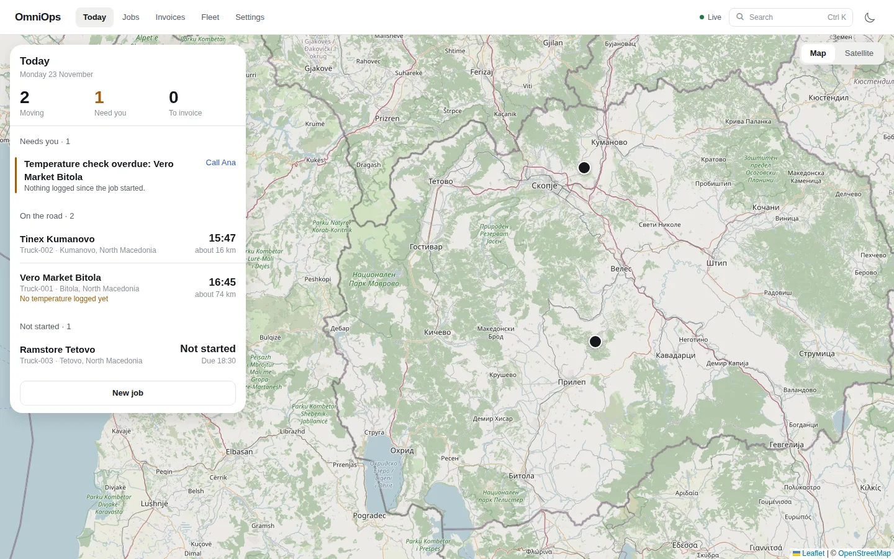
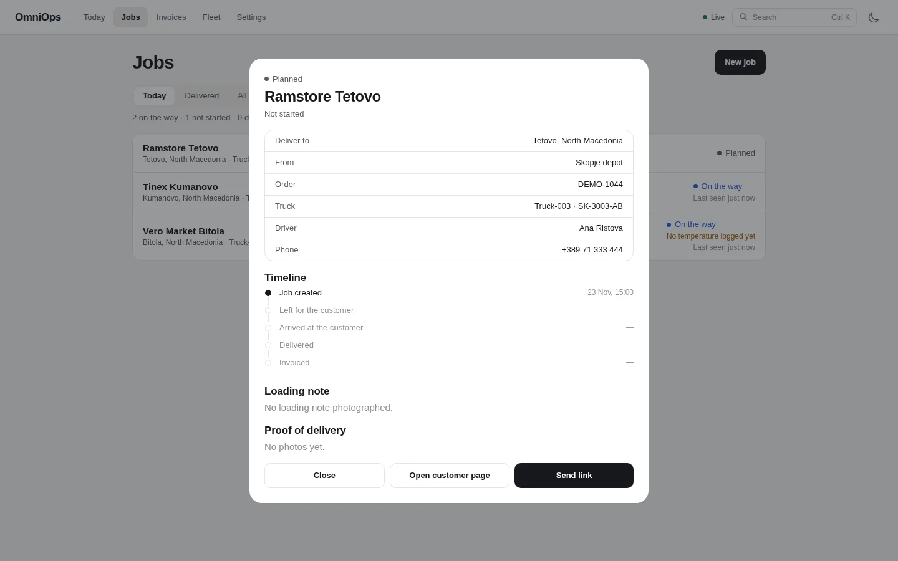
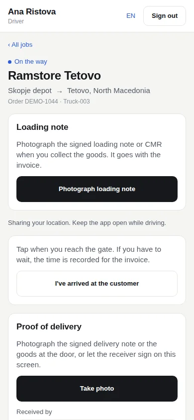
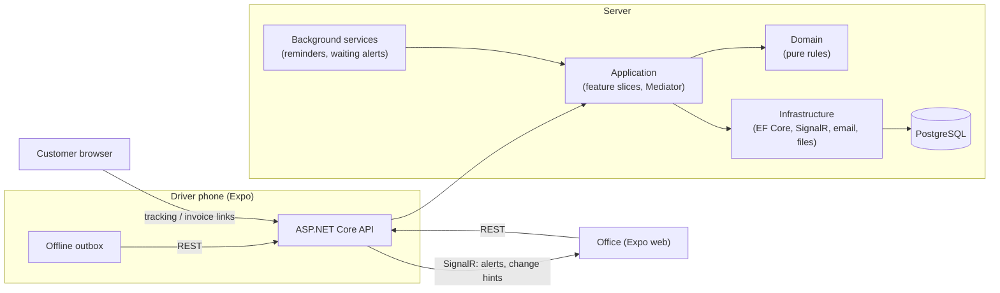

# OmniOps

Operations software for small trucking companies (1–30 trucks): plan deliveries, follow them live, collect proof of
delivery, and invoice the same day. The driver's own phone is the GPS tracker, camera and signature pad, so there is no
hardware to buy or install.

[](https://github.com/BogdanVladevski/OmniOps/actions/workflows/ci.yml)




## The product

OmniOps serves three people with one system:

| Who | What they get |
| --- | --- |
| **The office** (owner, dispatchers) | A *Today* screen: what's moving, what needs attention (late, no signal, temperature, waiting time), and money ready to invoice, each with one next step. Jobs, invoices with reminders, fleet, team. |
| **The driver** | One job at a time, one large button per step, in their own language (9 languages). Works without signal: every action is stored on the phone and sent in order later. |
| **The customer** | A tracking link with a live ETA, and an invoice page with the signed proof, photos and temperature log attached. |

What sets it apart from typical fleet tools:

- **Waiting time is billed with evidence.** Arrival and release at each stop come from the phone's GPS (or a checked
  "I've arrived" tap). Waiting past the free time becomes a priced invoice line, with the times as proof.
- **Proof that holds up.** Receiver signatures, loading notes and damage reports are captured on the phone. Blurry or
  dark document photos are flagged on the device before they're saved.
- **Delivered today, invoiced today.** A delivered job carries its paperwork straight into an invoice. Unpaid invoices
  get reminders, and the customer's page shows the proof.
- **Cold chain without sensors.** For refrigerated loads, drivers log readings with a photo of the unit's display, on a
  schedule the app enforces before hand-over.

<p>
  
  &nbsp;
  
</p>

## Architecture



- **Clean architecture with vertical slices.** Each feature (`src/OmniOps.Application/Features/*`) holds its command or
  query, validator, handler and DTOs together. Business rules that need no I/O (waiting time, invoice arithmetic,
  temperature policy, phone clock correction) live in `OmniOps.Domain` and are unit tested exhaustively.
- **Request pipeline.** [Mediator](https://github.com/martinothamar/Mediator) (source-generated, no reflection) runs
  logging → authorization → validation → transaction behaviours. Every message declares who may send it
  (`[RequiresPolicy]` or `[Anonymous]`), and an architecture test fails the build if one doesn't.
- **Multi-tenancy.** Each company's data is isolated by an EF Core named query filter, set from the signed-in account
  and never from the client. Integration tests check that companies can't see each other's data, including over the
  live channel.
- **Offline-first driver app.** Every driver action carries a client-generated id and the time on the phone. The server
  treats repeats as no-ops and clamps phone times to plausible bounds, so resending after a dropped connection is
  always safe.
- **Live updates.** The API pushes small "job changed" hints over SignalR, and screens refetch through TanStack Query.
  The server stays the single source of truth, and nothing stale is pushed.
- **A typed contract.** The OpenAPI document is generated at build time (`docs/api/omniops-api.json`), and the app's
  TypeScript client is generated from it, so a breaking API change fails the app's type check.

## Tech stack

| Area | Choices |
| --- | --- |
| Backend | .NET 10 / C# 14, ASP.NET Core minimal APIs, Mediator, FluentValidation, EF Core 10 + Npgsql, SignalR, OpenTelemetry |
| Data | PostgreSQL 17 |
| App | Expo SDK 58 (React Native 0.88, React 19, React Compiler), TypeScript, Expo Router, TanStack Query, openapi-fetch, react-native-maps / Leaflet |
| Local orchestration | .NET Aspire (PostgreSQL, API and app with one command, plus a dashboard for logs and traces) |
| Quality | xUnit v3, Testcontainers, Jest, ESLint, Prettier, analyzers with warnings as errors, central package management |
| Delivery | GitHub Actions, multi-stage Alpine container image, Trivy scan, Dependabot |

## Repository layout

```text
src/
  OmniOps.Domain            entities and pure business rules
  OmniOps.Application       feature slices: commands, queries, validators, handlers
  OmniOps.Infrastructure    EF Core, identity, email, file storage, background services
  OmniOps.Api               HTTP endpoints, authentication, SignalR hub, public pages
  OmniOps.ServiceDefaults   health checks, OpenTelemetry, resilience
  OmniOps.AppHost           Aspire: runs everything locally
tests/
  OmniOps.UnitTests         domain rules, architecture conventions
  OmniOps.IntegrationTests  the real API against PostgreSQL in Docker
app/                        Expo app: office (web, tablet) and driver (phone)
deploy/                     container image and a single-server compose file
docs/                       API contract and development guide
```

## Getting started

Prerequisites: .NET SDK 10, Node.js 22 or later, Docker.

```bash
dotnet tool restore                      # Aspire CLI and EF Core tools
(cd app && npm ci)
dotnet run --project src/OmniOps.AppHost
```

This starts PostgreSQL, the API on <http://localhost:5031> and the app on <http://localhost:8081>, and prints a link to
the Aspire dashboard. Choose **Try the demo company** on the sign-in screen, then *Settings → Load or refresh demo day*.
API reference: <http://localhost:5031/docs>.

More detail (running pieces separately, tests, migrations, the driver app on a phone):
[docs/development.md](docs/development.md).

## Tests

```bash
dotnet test --project tests/OmniOps.UnitTests          # fast, no Docker
dotnet test --project tests/OmniOps.IntegrationTests   # needs Docker
cd app && npm run lint && npm run typecheck && npm test
```

## Deployment

`deploy/compose.yaml` runs the API and PostgreSQL on a single server. See [deploy/.env.example](deploy/.env.example)
for the settings. The CI pipeline publishes the container image to GitHub Container Registry.

## License

Proprietary. All rights reserved. See [LICENSE](LICENSE).
